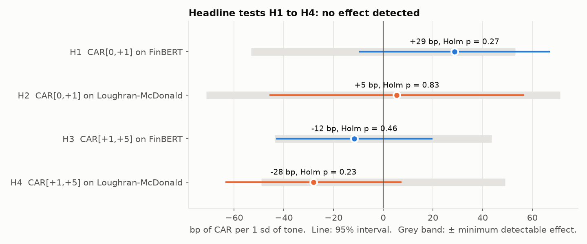
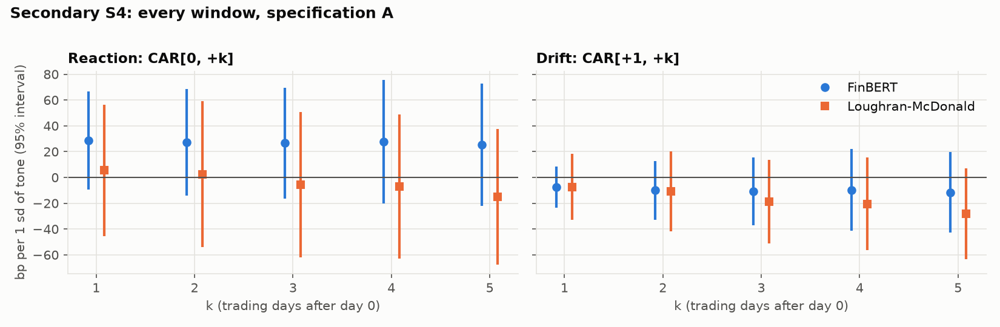
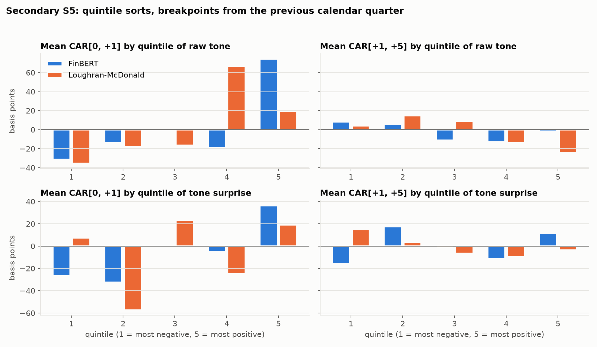

# Does the tone of earnings press releases move stock prices?

An event study of the earnings press releases of large US companies. It asks whether the tone of the release is associated with the stock's abnormal return when the news comes out, and whether it predicts the abnormal return over the following days. Tone is measured two ways and compared: FinBERT, a finance-tuned language model, and the Loughran-McDonald finance dictionary.

Sample: 55 firms (5 of the largest in each of the 11 GICS sectors), 1,316 quarterly earnings releases from 2019 to 2024, text and timestamps from SEC EDGAR. The analysis plan was written and committed before any sentiment score was put next to a return ([docs/stage4_analysis_plan.md](docs/stage4_analysis_plan.md)), and the four headline tests were run once.

*This README is generated by `scripts/18_readme.py` from the files in `results/`. Do not edit it by hand.*

## Headline result: no effect detected

Specification A: firm and calendar-quarter fixed effects, controls for the pre-event run-up and the stock's volatility (plus the day-0 abnormal return in the drift tests). 1,315 events; standard errors clustered by firm (55) and by event day (505). Coefficients are basis points of cumulative abnormal return (CAR) per one standard deviation of tone. Holm correction within each family of two tests.

| Test | Family | Outcome | Tone score | Coefficient (bp) | 95% interval (bp) | p | Holm p | MDE (bp) |
|---|---|---|---|---|---|---|---|---|
| H1 | reaction (association) | CAR[0,+1] | FinBERT | +28.7 | -9.3 to +66.7 | 0.136 | 0.272 | 53 |
| H2 | reaction (association) | CAR[0,+1] | Loughran-McDonald | +5.5 | -45.5 to +56.4 | 0.830 | 0.830 | 71 |
| H3 | drift (prediction) | CAR[+1,+5] | FinBERT | -11.6 | -42.8 to +19.6 | 0.459 | 0.459 | 44 |
| H4 | drift (prediction) | CAR[+1,+5] | Loughran-McDonald | -28.1 | -63.2 to +7.0 | 0.114 | 0.229 | 49 |

MDE: minimum detectable effect, the smallest effect this test would find with 80% power at the 5% level, computed from its realised standard error as SE x (1.960 + 0.842).



**None of the 4 headline tests is significant after the Holm correction** (smallest Holm-adjusted p-value 0.229; smallest unadjusted p-value 0.114). No effect of tone was detected, for either measure, on either the reaction or the drift. This is not evidence that tone has no effect: effects smaller than the MDE in the table, 44 to 71 bp per standard deviation of tone, cannot be ruled out, and the 95% intervals show the range of effects that remain compatible with the data.

How to read the two families:

- **Reaction (H1, H2)** asks whether tone is associated with the price move on days 0 to +1. The release and the move happen together, so this is an association, not a trading result.
- **Drift (H3, H4)** asks whether tone predicts the return on days +1 to +5. Because the day-0 abnormal return is a control, the coefficient measures prediction beyond what the day-0 reaction already reflects. Both drift estimates are negative (-11.6 and -28.1 bp), the opposite sign to a slow reaction to good news, and neither is distinguishable from zero.
- **FinBERT against the dictionary.** The data do not separate the two measures. With both scores in the same regression (secondary analysis S1), the test that their coefficients are equal gives p = 0.271 for the reaction and p = 0.446 for the drift. This study does not show that either method is better.

## Pre-specified secondary analyses

These were listed in the analysis plan before the join. They carry no multiple-testing claim across the set and do not replace or re-frame the headline result. Full tables: [docs/stage4_results.md](docs/stage4_results.md).

**Count.** Across S1, S2, S3, S4, S7 and S8 there are 88 coefficient estimates; 2 have an unadjusted p-value below 0.05, against about 4 expected by chance if every true effect were zero (the estimates overlap and are far from independent). Both are in S2.

### S2: pooled specification (sector instead of firm fixed effects): a cross-firm association

| Family | Tone score | Coefficient (bp) | 95% interval (bp) | p | Events |
|---|---|---|---|---|---|
| reaction (association) | FinBERT | +29.1 | +5.0 to +53.3 | 0.019 | 1,315 |
| reaction (association) | Loughran-McDonald | +33.4 | +10.3 to +56.4 | 0.005 | 1,315 |
| drift (prediction) | FinBERT | -10.8 | -32.5 to +10.9 | 0.322 | 1,315 |
| drift (prediction) | Loughran-McDonald | -8.0 | -26.8 to +10.7 | 0.393 | 1,315 |

Without firm fixed effects, both tone measures are associated with the reaction. A large share of the variation in tone is between firms (each company has a house style), so this coefficient compares firms with each other: firms whose releases are habitually more positive had better reactions on average in this sample. It is a cross-firm association and **not an effect of tone on returns**: firm-level differences such as industry, size or business quality could produce it. The headline specification, which compares each firm with itself, detects no effect. The drift coefficients are not significant in this specification either.

### S3: tone surprise (tone minus the firm's average over its previous four releases)

| Family | Tone score | Coefficient (bp) | 95% interval (bp) | p | Events |
|---|---|---|---|---|---|
| reaction (association) | FinBERT surprise | +29.1 | -4.3 to +62.4 | 0.087 | 1,087 |
| reaction (association) | Loughran-McDonald surprise | +8.0 | -26.2 to +42.3 | 0.640 | 1,087 |
| drift (prediction) | FinBERT surprise | -15.9 | -39.0 to +7.3 | 0.175 | 1,087 |
| drift (prediction) | Loughran-McDonald surprise | -16.6 | -43.0 to +9.8 | 0.214 | 1,087 |

0 of the 8 tone-surprise coefficients (each score alone and both together) has a p-value below 0.05.

### S4: horizon profile

Specification A for every window from CAR[0,+1] to CAR[0,+5] and from AR[+1] to CAR[+1,+5]: 0 of 20 coefficients have an unadjusted p-value below 0.05, and 0 after the Holm correction across the five windows.



### S5: quintile sorts

Events are sorted into quintiles of tone with breakpoints from the previous calendar quarter only. The spread is the mean CAR of the most positive quintile minus the most negative, with standard errors clustered by firm and event day.

| Sorted on | Outcome | Events | Q5 minus Q1 (bp) | SE (bp) | p |
|---|---|---|---|---|---|
| FinBERT | CAR[0,+1] | 1,262 | +105.9 | 39.4 | 0.009 |
| FinBERT | CAR[+1,+5] | 1,262 | -10.2 | 25.3 | 0.687 |
| Loughran-McDonald | CAR[0,+1] | 1,262 | +55.0 | 37.3 | 0.146 |
| Loughran-McDonald | CAR[+1,+5] | 1,262 | -28.1 | 29.6 | 0.347 |
| FinBERT surprise | CAR[0,+1] | 1,034 | +62.9 | 56.0 | 0.266 |
| FinBERT surprise | CAR[+1,+5] | 1,034 | +26.8 | 33.3 | 0.425 |
| Loughran-McDonald surprise | CAR[0,+1] | 1,034 | +11.8 | 44.9 | 0.793 |
| Loughran-McDonald surprise | CAR[+1,+5] | 1,034 | -18.6 | 29.1 | 0.525 |

**1 of 8 spreads** has a p-value below 0.05: FinBERT on CAR[0,+1], +105.9 bp (p = 0.009). Raw-tone sorts compare firms with different house styles, like S2. The same sort on FinBERT tone surprise, which compares each firm with its own recent past, gives +62.9 bp (p = 0.266). No drift spread is significant.



### S6 to S8: robustness of H1 to H4

| Check | Re-estimates of H1 to H4 | With p below 0.05 |
|---|---|---|
| S6: other clusterings (firm, quarter) | 8 | 0 |
| S7: other samples (4 flagged groups removed one at a time, and the tone-surprise sample) | 20 | 0 |
| S8: other measures (7 variants: safe-harbor text kept, alternative scores, 4-factor and sector-ETF CARs, winsorised CARs, buy-and-hold returns) | 24 | 0 |

No robustness check turns a headline test significant, even before any multiple-testing correction.

## Exploratory analyses (not tests of the hypothesis)

Nothing here was a pre-specified test. It is descriptive and not corrected for multiple comparisons.

| Family | Version | Tone score | Spearman correlation with CAR | 95% interval (firm bootstrap) |
|---|---|---|---|---|
| reaction (association) | pooled | FinBERT | +0.062 | +0.004 to +0.111 |
| reaction (association) | pooled | Loughran-McDonald | +0.061 | +0.008 to +0.109 |
| reaction (association) | within firm | FinBERT | +0.052 | -0.011 to +0.111 |
| reaction (association) | within firm | Loughran-McDonald | +0.027 | -0.024 to +0.081 |
| drift (prediction) | pooled | FinBERT | -0.019 | -0.076 to +0.040 |
| drift (prediction) | pooled | Loughran-McDonald | -0.020 | -0.080 to +0.034 |
| drift (prediction) | within firm | FinBERT | -0.004 | -0.064 to +0.053 |
| drift (prediction) | within firm | Loughran-McDonald | -0.024 | -0.082 to +0.032 |

- **Sub-samples.** Specification A was re-run in 6 sub-samples (2020 only, all years except 2020, pre-open and after-close releases, larger and smaller half of firms), 24 coefficients in all. **1 of 24** has a p-value below 0.05: FinBERT drift among pre-open events, -33.6 bp (p = 0.018, 937 events). With this many splits, about 1 would be expected by chance; it is not read as a finding.
- **Drift without the day-0 control.** Removing the day-0 abnormal return from the drift equation barely changes the estimates: FinBERT -10.2 bp (p = 0.504), Loughran-McDonald -27.6 bp (p = 0.121).
- **Earnings-surprise control.** Not run: the EPS history was not assembled. It is listed under next steps.

## Data and sources

| Input | Source | Notes |
|---|---|---|
| Earnings press releases | SEC EDGAR, form 8-K Item 2.02, Exhibit 99.1 | Public filings. Raw text is not redistributed here |
| Event timestamps | EDGAR acceptance time (UTC, converted to US Eastern) | Mapped to trading sessions with the NYSE calendar |
| Firm basket | Select Sector SPDR Trust form N-Q, holdings at 2018-12-31 | The 5 largest firms in each of the 11 GICS sectors, fixed before the sample starts |
| Prices | Yahoo Finance via `yfinance` | Daily returns and volume for stocks, SPY and sector ETFs |
| Factors | Ken French data library | Daily Fama-French 3 factors and momentum (robustness only) |
| Dictionary | Loughran-McDonald Master Dictionary | Download it yourself (see below). Not redistributed |

One release per firm and fiscal quarter: 1,316 events, 1,315 in the headline sample (one event lacks the run-up control) and 1,087 with a tone surprise. The selection rule and the dropped filings are documented in [docs/stage1_event_rule.md](docs/stage1_event_rule.md).

## Method

- **Event clock.** Day 0 is the first NYSE session in which the market could trade on the release, from the EDGAR acceptance time: 938 releases arrived before the open, 23 during market hours and 355 after the close. For 15 events (BRK-B 14, LIN 1) the 10-Q or 10-K reached EDGAR first, and its earlier time is used. A timing check confirms the clock: in every bucket the mean absolute abnormal return and the abnormal volume peak on day 0 (mean |AR| on day -1 / 0 / +1: pre-open 96 / 281 / 132 bp; market hours 82 / 255 / 114 bp; after close 121 / 428 / 137 bp). Details: [docs/stage2_event_study.md](docs/stage2_event_study.md).
- **Text cleaning.** Tables, the safe-harbor (forward-looking statements) boilerplate and non-prose lines are removed, and the text is split into sentences of 5 to 120 words. The median release keeps 2,654 words in 126 sentences (192,314 sentences in all, 112,172 distinct). The rules were frozen before any return was looked at: [docs/stage3_scoring_spec.md](docs/stage3_scoring_spec.md).
- **FinBERT.** `ProsusAI/finbert` at revision `0bc2ac10dda6`, maximum 128 tokens (2,541 of 112,172 distinct sentences were truncated). Release tone is the mean over sentences of P(positive) minus P(negative).
- **Loughran-McDonald.** Tone = (positive - negative) / (positive + negative) word counts summed over the release; a positive word is not counted when one of NEITHER, NEVER, NO, NOBODY, NONE, NOT occurs within the 3 words before it.
- **Tone surprise.** Tone minus the firm's mean over its previous 4 releases, all within 380 days.
- **Abnormal returns.** Market model against SPY, estimated over relative days [-250, -11] with at least 120 observations, so the estimation window ends before the event.
- **Regressions.** Ordinary least squares with firm and calendar-quarter fixed effects; standard errors two-way clustered by firm and event day (Cameron-Gelbach-Miller) with a small-sample correction; Holm correction within each family.
- **Validation on simulated data** before the real run: a planted 50 bp effect was recovered as 49.3 and 49.7 bp, a zero effect was rejected 4.9% and 5.1% of the time at the 5% level, and the two-way clustered standard error matched an independent statsmodels implementation (relative difference 6e-15). See [docs/stage4_validation.md](docs/stage4_validation.md).

## Limits

- **Very large firms only.** 55 of the largest US companies. Their prices absorb news quickly, so the results may not carry over to smaller firms.
- **Press releases, not call transcripts.** Much of the information, and the tone of management's answers, is in the earnings call, which this study does not use.
- **2019 to 2024 only**, a period that includes the 2020 pandemic shock.
- **Earnings news is not controlled for.** Neither family controls for the earnings surprise. In the reaction family a positive association could simply reflect good results being described in positive words.
- **Power.** With 1,315 events and firm fixed effects, effects smaller than 44 to 71 bp per standard deviation of tone cannot be detected. Drift effects of a few basis points, the size often reported for large firms, are well below that.
- **The two measures overlap.** FinBERT and dictionary tone correlate at 0.54 (Pearson) across releases.
- **Event time** is the EDGAR acceptance time, which can lag the newswire release. The timing check shows that the day-0 assignment works.

## How to run

Windows PowerShell, Python 3.11, no GPU needed.

```powershell
py -3.11 -m venv .venv
.\.venv\Scripts\python.exe -m pip install -r requirements.txt
.\.venv\Scripts\python.exe -m pip install -e .
Copy-Item .env.example .env
```

**SEC User-Agent.** SEC EDGAR requires every automated request to identify itself. Open `.env` and replace the placeholder in `SEC_USER_AGENT` with your own name and contact email. `.env` is git-ignored; never commit it.

**Loughran-McDonald dictionary.** Download the Master Dictionary CSV yourself from the authors' page, <https://sraf.nd.edu/loughranmcdonald-master-dictionary/>, and save it in `data/external/` with its original name (`Loughran-McDonald_MasterDictionary_*.csv`). That folder is git-ignored. Check the licence terms on that page.

Then run the scripts in order:

```powershell
.\.venv\Scripts\python.exe scripts\01a_holdings_and_issuers.py   # basket: SPDR holdings and issuers
.\.venv\Scripts\python.exe scripts\01b_market_caps.py            # basket: market caps
.\.venv\Scripts\python.exe scripts\01d_select_basket.py          # basket: top firms per sector
.\.venv\Scripts\python.exe scripts\02_fetch_filings.py           # EDGAR filings and exhibits (rate-limited, cached)
.\.venv\Scripts\python.exe scripts\03_select_events.py           # one release per firm-quarter
.\.venv\Scripts\python.exe scripts\04_fetch_prices.py            # prices and factors
.\.venv\Scripts\python.exe scripts\05_data_quality.py
.\.venv\Scripts\python.exe scripts\06_price_artifacts.py
.\.venv\Scripts\python.exe scripts\07_event_study.py             # abnormal returns
.\.venv\Scripts\python.exe scripts\08_stage2_report.py           # timing check
.\.venv\Scripts\python.exe scripts\09_build_sentences.py         # cleaning and sentences
.\.venv\Scripts\python.exe scripts\10_pilot.py                   # optional: 5-firm FinBERT pilot
.\.venv\Scripts\python.exe scripts\11_safe_harbor_audit.py
.\.venv\Scripts\python.exe scripts\12_score_finbert.py           # FinBERT on CPU: about 79 minutes, resumable
.\.venv\Scripts\python.exe scripts\13_stage3_report.py           # score checks
.\.venv\Scripts\python.exe scripts\14_power.py                   # power, before the join
.\.venv\Scripts\python.exe scripts\15_validate_stage4.py         # validation on simulated data
.\.venv\Scripts\python.exe scripts\16_headline.py                # H1 to H4; refuses to run if results/stage4/headline_results.csv exists
.\.venv\Scripts\python.exe scripts\17_secondary.py               # S1 to S8, exploratory, docs/stage4_results.md
.\.venv\Scripts\python.exe scripts\18_readme.py                  # this README and its figures
.\.venv\Scripts\python.exe -m pytest -q
```

FinBERT scoring time, measured on this project's CPU run (`results/stage3/finbert_scores.meta.json`): 104,187 sentences in 79 minutes, 22 sentences per second (`torch 2.15.0+cpu`), after the pilot had scored 7,985 sentences in 6 minutes with 4 CPU threads. Scoring saves its progress and resumes if interrupted. `scripts/01c_cover_page_shares.py` only prints the cover-page share counts that were checked by hand for multi-class firms (`data/reference/multiclass_shares.csv`).

`scripts/18_readme.py --check` and `tests/test_readme.py` fail if this README differs from what the saved results produce.

## Licences and intended use

- This is **non-commercial research**, published as a portfolio project.
- FinBERT (`ProsusAI/finbert`) is licensed CC BY-NC-SA 4.0 (non-commercial, share-alike).
- The Loughran-McDonald dictionary is free for academic research; commercial use needs a licence from its authors. It is not included in this repository.
- Prices come from Yahoo Finance through `yfinance`, for personal research use; price files are not committed.
- Raw filing text, price files and the dictionary are never committed. The repository holds code, derived scores and results.
- **Not investment advice.** Nothing here is a recommendation to buy or sell any security.

## What I would do next

- Add the earnings-surprise control (seasonal random-walk EPS surprise from EDGAR XBRL), so that tone can be separated from the news in the numbers.
- Score earnings-call transcripts, especially the question-and-answer section, from a source with clear redistribution rights.
- Extend to smaller firms and a longer period: more events would lower the MDE, and smaller firms are where slow reactions are more plausible.
- Use newswire timestamps to measure the reaction in intraday windows.
- Score the outlook or guidance sections on their own, where forward-looking tone is concentrated.
- Write and commit a new analysis plan before any of these, as was done here.

## Stage reports

- [Stage 0: feasibility](docs/stage0_feasibility.md)
- [Stage 1: event selection rule](docs/stage1_event_rule.md)
- [Stage 1: data quality](docs/stage1_data_quality.md)
- [Stage 1: price artifacts](docs/stage1_price_artifacts.md)
- [Stage 2: event study and timing check](docs/stage2_event_study.md)
- [Stage 3: frozen scoring specification](docs/stage3_scoring_spec.md)
- [Stage 3: pilot](docs/stage3_pilot_report.md)
- [Stage 3: score checks](docs/stage3_scores_report.md)
- [Stage 4: analysis plan (committed before the join)](docs/stage4_analysis_plan.md)
- [Stage 4: validation on simulated data](docs/stage4_validation.md)
- [Stage 4: all results](docs/stage4_results.md)
