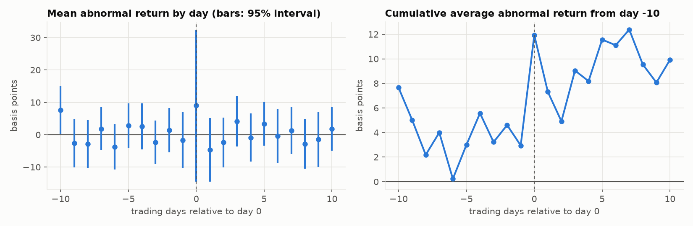
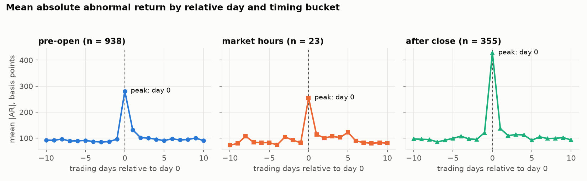
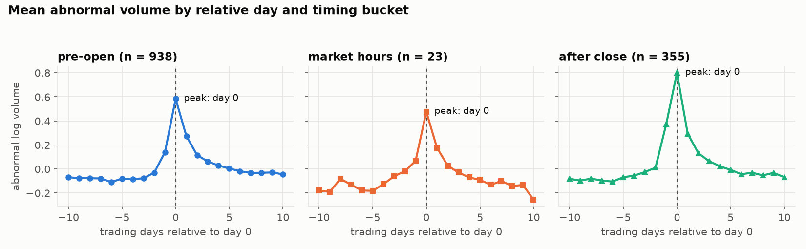
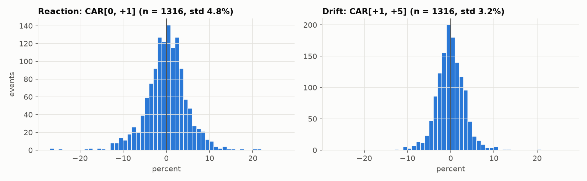

# Stage 2: event study and timing check

Generated by `scripts/08_stage2_report.py` from the outputs of `scripts/07_event_study.py`. Every number is computed by that code.

## 1. Method

- Events: **1316** earnings releases of 55 firms, day 0 from the approved event clock.
- Returns: simple daily returns from dividend- and split-adjusted closes.
- Primary model: market model on SPY, estimated over relative days [-250, -11] (at least 120 observations). AR = R - (alpha + beta x R_SPY).
- Robustness models computed alongside: Fama-French 3 factors plus momentum (`_ff4`), and a market model on the firm's sector ETF (`_sector`).
- CAR[a,b] is the sum of daily ARs. Reaction family: CAR[0,+1] to CAR[0,+5]. Drift family: AR[+1], CAR[+1,+2] to CAR[+1,+5].
- Abnormal volume: log volume minus the mean log volume of the estimation window.
- The 10 spin-off and merger adjustment days listed in `docs/stage1_price_artifacts.md` are removed from estimation windows. None falls inside an event window [-1, +5].
- Earlier earnings dates of the same firm sit inside the estimation window and are not removed. This is standard and makes the residual volatility slightly conservative.

## 2. Estimation diagnostics (market model)

Events with fewer than 120 estimation observations: **0**. Events with a missing AR inside [-1, +5]: **0**.

| quantity | min | 25% | 50% | 75% | max |
|---|---|---|---|---|---|
| n_est | 238.0000 | 240.0000 | 240.0000 | 240.0000 | 240.0000 |
| alpha | -0.0045 | -0.0005 | 0.0001 | 0.0006 | 0.0032 |
| beta | -0.0160 | 0.5444 | 0.8612 | 1.1030 | 2.1649 |
| r2 | 0.0001 | 0.1666 | 0.3227 | 0.5168 | 0.8660 |
| sigma | 0.0054 | 0.0106 | 0.0129 | 0.0154 | 0.0487 |

## 3. Sanity check: abnormal returns by relative day (all events)

The t-statistic is a plain cross-sectional one (no clustering); it is a sanity check, not a result.

| day | n | mean_ar_bp | t_stat | mean_abs_ar_bp | mean_abs_sar | mean_abn_log_volume |
|---|---|---|---|---|---|---|
| -10 | 1316 | 7.65 | 2.02 | 93.47 | 0.68 | -0.07 |
| -9 | 1316 | -2.63 | -0.69 | 92.32 | 0.68 | -0.08 |
| -8 | 1316 | -2.84 | -0.75 | 96.16 | 0.71 | -0.08 |
| -7 | 1315 | 1.81 | 0.54 | 87.76 | 0.64 | -0.08 |
| -6 | 1316 | -3.77 | -1.07 | 90.05 | 0.66 | -0.11 |
| -5 | 1316 | 2.77 | 0.79 | 93.08 | 0.69 | -0.08 |
| -4 | 1316 | 2.58 | 0.71 | 92.21 | 0.68 | -0.08 |
| -3 | 1316 | -2.35 | -0.68 | 88.67 | 0.66 | -0.06 |
| -2 | 1316 | 1.38 | 0.40 | 88.93 | 0.66 | -0.02 |
| -1 | 1316 | -1.66 | -0.38 | 102.44 | 0.75 | 0.20 |
| 0 | 1316 | 8.99 | 0.75 | 320.16 | 2.42 | 0.64 |
| 1 | 1316 | -4.63 | -0.92 | 133.09 | 0.99 | 0.28 |
| 2 | 1316 | -2.39 | -0.61 | 104.06 | 0.78 | 0.12 |
| 3 | 1316 | 4.13 | 1.04 | 103.93 | 0.78 | 0.06 |
| 4 | 1316 | -0.86 | -0.23 | 100.00 | 0.74 | 0.03 |
| 5 | 1316 | 3.38 | 0.98 | 91.30 | 0.69 | -0.00 |
| 6 | 1316 | -0.46 | -0.11 | 99.36 | 0.73 | -0.03 |
| 7 | 1316 | 1.28 | 0.35 | 94.20 | 0.70 | -0.03 |
| 8 | 1316 | -2.85 | -0.73 | 95.63 | 0.71 | -0.04 |
| 9 | 1316 | -1.46 | -0.34 | 100.54 | 0.75 | -0.03 |
| 10 | 1316 | 1.85 | 0.54 | 90.74 | 0.68 | -0.05 |

- Mean AR over days [-10, -2]: **0.51 bp** per day (largest absolute t-statistic among those days: 2.02).
- Mean absolute AR on day 0: **320 bp**, against **91 bp** on days [-10, -2], a ratio of **3.50**.
- Mean abnormal log volume on day 0: **0.64** (volume about 1.90 times normal), against -0.07 on days [-10, -2].

## 4. Timing check: is the spike on day 0?

If the EDGAR-based clock is right, both the absolute abnormal return and abnormal volume should peak on day 0 in every bucket. A peak on day -1 would mean the news reached the market before our timestamp; a peak on day +1 would mean day 0 is set one session too early.

| bucket | events | |AR| day -1 (bp) | |AR| day 0 (bp) | |AR| day +1 (bp) | |AR| peak day | volume day -1 | volume day 0 | volume day +1 | volume peak day |
|---|---|---|---|---|---|---|---|---|---|
| pre-open | 938 | 95.95 | 281.03 | 132.07 | 0 | 0.14 | 0.58 | 0.27 | 0 |
| market hours | 23 | 82.17 | 254.65 | 113.96 | 0 | 0.07 | 0.48 | 0.18 | 0 |
| after close | 355 | 120.89 | 427.80 | 137.02 | 0 | 0.37 | 0.80 | 0.30 | 0 |

Share of events (%) whose own largest absolute AR within [-3, +3] falls on each day (with 7 days, a pure-noise benchmark is 14.3% per day):

| bucket | day -3 | day -2 | day -1 | day 0 | day +1 | day +2 | day +3 |
|---|---|---|---|---|---|---|---|
| pre-open | 6.0 | 5.9 | 6.9 | 54.3 | 13.5 | 6.5 | 6.9 |
| market hours | 4.3 | 0.0 | 13.0 | 60.9 | 4.3 | 13.0 | 4.3 |
| after close | 5.9 | 5.4 | 5.1 | 64.2 | 9.3 | 4.5 | 5.6 |

After-close filings split by acceptance time. Day 0 is the next session for both groups; the split only checks that late-evening filings behave the same way:

| after-close sub-group | events | |AR| day -1 (bp) | |AR| day 0 (bp) | |AR| day +1 (bp) | volume day -1 | volume day 0 | volume day +1 |
|---|---|---|---|---|---|---|---|
| accepted 16:00-17:29 | 318 | 127.66 | 449.95 | 139.88 | 0.40 | 0.83 | 0.30 |
| accepted 17:30 or later | 37 | 62.70 | 237.38 | 112.51 | 0.17 | 0.56 | 0.26 |

### Per firm

Firms whose mean standardised absolute AR and mean abnormal volume both peak on day 0 (within [-3, +3]): **54 of 55**. Firms where either peak is on another day:

| ticker | events | main bucket | |SAR| day -1 | |SAR| day 0 | |SAR| day +1 | |SAR| peak day | volume day -1 | volume day 0 | volume day +1 | volume peak day |
|---|---|---|---|---|---|---|---|---|---|---|
| D | 24 | pre-open | 0.70 | 1.25 | 1.27 | 1 | 0.02 | 0.26 | 0.26 | 0 |

The full per-firm table is `results/stage2/timing_check_by_firm.csv`.

### The 15 clock-adjusted events (Berkshire and Linde)

Same events, day 0 taken from the adjusted clock (10-Q/10-K acceptance) and from the unadjusted 8-K clock:

| day | |AR| adjusted clock (bp) | |AR| 8-K clock (bp) | volume adjusted clock | volume 8-K clock |
|---|---|---|---|---|
| -3 | 44.43 | 62.00 | -0.13 | 0.06 |
| -2 | 44.18 | 68.67 | -0.09 | 0.08 |
| -1 | 84.83 | 96.83 | 0.13 | 0.21 |
| 0 | 104.66 | 61.89 | 0.26 | 0.06 |
| 1 | 61.66 | 37.31 | 0.12 | 0.04 |
| 2 | 51.03 | 54.67 | -0.06 | 0.10 |
| 3 | 53.35 | 68.96 | 0.08 | 0.08 |

Peak day of mean |AR|: adjusted clock **0**, 8-K clock **-1**. Peak day of abnormal volume: adjusted clock **0**, 8-K clock **-1**. With so few events this comparison is indicative only.

## 5. Cumulative abnormal returns (market model)

Unconditional averages across all events. They are expected to be near zero: the hypothesis is about how CARs vary with sentiment, which is Stage 4.

| window | column | n | mean (bp) | median (bp) | std (%) | t-stat | % positive |
|---|---|---|---|---|---|---|---|
| [0, 0] | car_0_0 | 1316 | 8.99 | 30.00 | 4.35 | 0.75 | 53.04 |
| [0, +1] | car_0_1 | 1316 | 4.36 | 25.38 | 4.81 | 0.33 | 52.28 |
| [0, +2] | car_0_2 | 1316 | 1.97 | 16.06 | 5.13 | 0.14 | 51.82 |
| [0, +3] | car_0_3 | 1316 | 6.10 | 13.79 | 5.31 | 0.42 | 50.99 |
| [0, +4] | car_0_4 | 1316 | 5.24 | 18.57 | 5.44 | 0.35 | 51.67 |
| [0, +5] | car_0_5 | 1316 | 8.62 | 32.01 | 5.55 | 0.56 | 52.66 |
| [+1, +1] | ar_1 | 1316 | -4.63 | -7.64 | 1.82 | -0.92 | 48.02 |
| [+1, +2] | car_1_2 | 1316 | -7.02 | -12.40 | 2.33 | -1.09 | 47.26 |
| [+1, +3] | car_1_3 | 1316 | -2.89 | -6.76 | 2.66 | -0.39 | 48.40 |
| [+1, +4] | car_1_4 | 1316 | -3.75 | -3.68 | 2.95 | -0.46 | 49.62 |
| [+1, +5] | car_1_5 | 1316 | -0.37 | -8.21 | 3.21 | -0.04 | 48.71 |
| [-20, -1] | car_m20_m1 | 1315 | -18.79 | -23.45 | 5.95 | -1.15 | 47.98 |
| [-10, -2] | car_m10_m2 | 1315 | 4.43 | 4.16 | 3.84 | 0.42 | 50.95 |

## 6. Agreement between expected-return models

| window | n ff4 | n sector | corr market vs ff4 | corr market vs sector | std market (%) | std ff4 (%) | std sector (%) |
|---|---|---|---|---|---|---|---|
| car_0_1 | 1316 | 1316 | 0.978 | 0.951 | 4.805 | 4.697 | 4.215 |
| car_1_5 | 1316 | 1316 | 0.891 | 0.773 | 3.209 | 2.939 | 2.475 |

Sector-model events with fewer than 120 estimation observations: 0 (the Communication Services ETF only started trading in June 2018).
