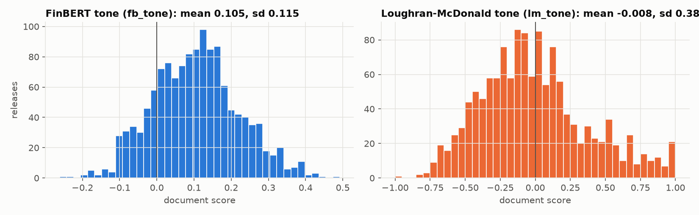
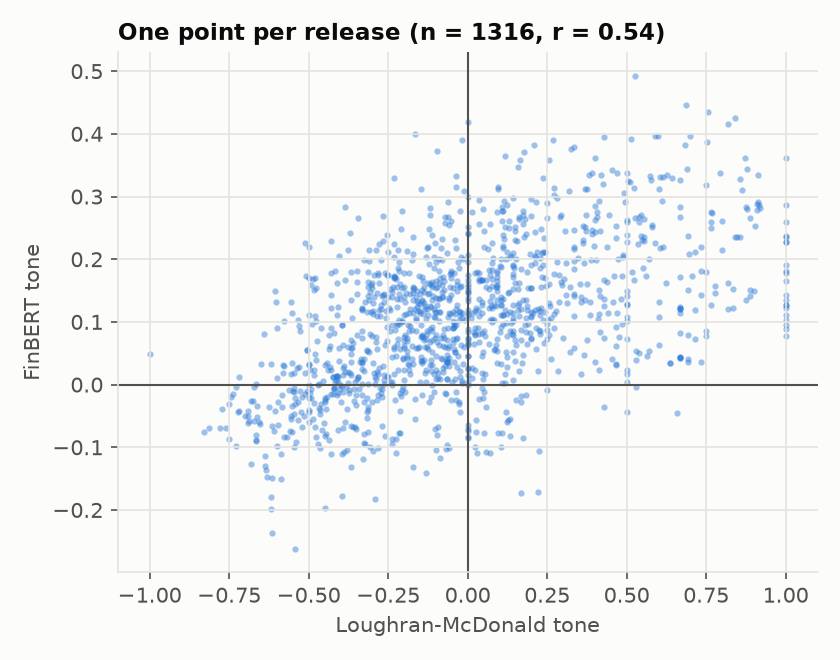

# Stage 3: sentiment scores and sanity checks

Generated by `scripts/13_stage3_report.py` with the rules frozen in `docs/stage3_scoring_spec.md`. **No price, return or CAR is read in Stage 3.** The only relationships computed are between the two sentiment methods and between the two text versions.

## 1. Verification of the scoring run

| check | value |
|---|---|
| distinct sentences across both versions | 112172 |
| distinct sentences with a FinBERT score | 112172 |
| distinct sentences without a score | 0 |
| duplicate score rows | 0 |
| main: sentences | 192314 |
| main: sentences without a score | 0 |
| main: events with at least one sentence (of 1316) | 1316 |
| with_sh: sentences | 207886 |
| with_sh: sentences without a score | 0 |
| with_sh: events with at least one sentence (of 1316) | 1316 |

FinBERT: `ProsusAI/finbert` at revision `0bc2ac10dda6929bcb1f77ccc43c7ec5c424f031`, float32 on CPU, `max_length` 128, batch 32. Loughran-McDonald file: `Loughran-McDonald_MasterDictionary_1993-2025.csv`.

## 2. Sentences truncated at 128 tokens

- Distinct sentences: 2,541 of 112,172 (**2.27%**).
- Sentence occurrences in the main version: 2,653 of 192,314 (**1.38%**).
- Releases with at least one truncated sentence: 809 of 1316; mean share of a release's sentences that are truncated: 1.32%, maximum 12.0%.
- Token length of scored sentences: median 33, 95% 89, maximum 500.

Firms with the highest mean share of truncated sentences (%): EOG 4.9, BAC 4.0, NEE 3.8, AMT 3.5, RTX 2.9, DD 2.8.

## 3. Score distributions (1,316 releases)

`_sh` is the version that keeps safe-harbor text. Tone surprise needs four prior quarters.

| score | n | mean | std | min | 5% | 25% | median | 75% | 95% | max |
|---|---|---|---|---|---|---|---|---|---|---|
| fb_tone | 1316 | 0.105 | 0.115 | -0.262 | -0.079 | 0.023 | 0.108 | 0.174 | 0.303 | 0.492 |
| fb_tone_labels | 1316 | 0.116 | 0.127 | -0.307 | -0.084 | 0.027 | 0.113 | 0.196 | 0.333 | 0.545 |
| lm_tone | 1316 | -0.008 | 0.382 | -1.000 | -0.558 | -0.278 | -0.053 | 0.200 | 0.733 | 1.000 |
| lm_tone_per_word | 1316 | -0.001 | 0.009 | -0.028 | -0.015 | -0.006 | -0.001 | 0.004 | 0.016 | 0.026 |
| fb_tone_surprise | 1088 | -0.001 | 0.087 | -0.487 | -0.139 | -0.042 | -0.001 | 0.038 | 0.139 | 0.392 |
| lm_tone_surprise | 1088 | -0.013 | 0.211 | -1.355 | -0.357 | -0.124 | -0.000 | 0.110 | 0.303 | 0.674 |
| fb_tone_sh | 1316 | 0.088 | 0.109 | -0.252 | -0.087 | 0.012 | 0.089 | 0.154 | 0.270 | 0.482 |
| lm_tone_sh | 1316 | -0.079 | 0.352 | -1.000 | -0.576 | -0.335 | -0.111 | 0.120 | 0.612 | 1.000 |

- FinBERT sentence labels, main version: 23.8% positive, 13.2% negative, 62.9% neutral.
- Loughran-McDonald, main version: 39,550 positive and 48,305 negative word hits; 339 positive words cancelled by the negation rule (0.85% of positive hits).
- Releases with no Loughran-McDonald sentiment word (score missing): 0.
- Sentiment-word hits per release (positive + negative): minimum 4, 5% 12, median 50. Releases with fewer than 20 hits: 162. Releases where `lm_tone` is exactly +1 or -1 because every hit has the same sign: **22** ({'AAPL': 13, 'MSFT': 7, 'EOG': 1, 'SO': 1}). With few hits the ratio (pos - neg)/(pos + neg) is coarse; `lm_tone_per_word` does not saturate (correlation with `lm_tone`: 0.953).
- Share of the variance that lies between firms: `fb_tone` 48%, `lm_tone` 68%. The rest is variation within a firm over time, which is what the headline specification with firm fixed effects uses.

Mean scores by year of release (a plausibility check: 2020 should look worse than its neighbours):

| year | releases | fb_tone | lm_tone | share_pos | share_neg |
|---|---|---|---|---|---|
| 2019 | 219 | 0.106 | 0.056 | 0.235 | 0.121 |
| 2020 | 220 | 0.057 | -0.054 | 0.219 | 0.155 |
| 2021 | 220 | 0.120 | 0.019 | 0.253 | 0.122 |
| 2022 | 218 | 0.123 | -0.009 | 0.255 | 0.121 |
| 2023 | 220 | 0.118 | -0.027 | 0.252 | 0.121 |
| 2024 | 219 | 0.107 | -0.032 | 0.240 | 0.122 |

Mean scores by sector:

| sector | releases | fb_tone | lm_tone |
|---|---|---|---|
| Communication Services | 120 | 0.077 | 0.006 |
| Consumer Discretionary | 120 | 0.149 | 0.165 |
| Consumer Staples | 120 | 0.105 | -0.161 |
| Energy | 120 | 0.137 | -0.048 |
| Financials | 119 | 0.075 | -0.089 |
| Health Care | 120 | 0.182 | 0.106 |
| Industrials | 120 | 0.078 | -0.218 |
| Information Technology | 120 | 0.126 | 0.217 |
| Materials | 118 | 0.122 | 0.007 |
| Real Estate | 120 | 0.053 | 0.015 |
| Utilities | 119 | 0.051 | -0.089 |

## 4. Agreement between FinBERT and Loughran-McDonald

| pair | n | Pearson | Spearman | within firm (Pearson) |
|---|---|---|---|---|
| primary scores | 1316 | 0.541 | 0.537 | 0.475 |
| FinBERT label version vs LM | 1316 | 0.521 | 0.514 | 0.461 |
| FinBERT vs LM per word | 1316 | 0.545 | 0.531 | 0.497 |
| tone surprises | 1088 | 0.464 | 0.455 | 0.459 |
| primary scores, safe-harbor text kept | 1316 | 0.528 | 0.523 | 0.474 |

"Within firm" removes each firm's own mean from both scores first, so it measures whether the two methods move together over time for the same firm.

Correlation computed separately for each of the 55 firms: minimum -0.51, 25% 0.31, median **0.54**, 75% 0.72, maximum 0.92. Firms with a negative correlation: 4.

Lowest five: MSFT -0.51, APD -0.40, SHW -0.26, V -0.10, JPM 0.14. Highest five: D 0.81, AMT 0.84, SLB 0.89, INTC 0.90, PM 0.92. Full list: `results/stage3/method_correlation_by_firm.csv`.

Effect of the safe-harbor removal on each method:

| method | Pearson main vs with safe-harbor text | mean change (with - main) | largest absolute change |
|---|---|---|---|
| FinBERT | 0.968 | -0.017 | 0.300 |
| Loughran-McDonald | 0.930 | -0.071 | 1.400 |

## 5. Most positive and most negative releases, per method

Percentiles are ranks within the 1,316 releases (100 = most positive). The sentences behind each row are written to `data/interim/stage3_excerpts.txt`, which is git-ignored because it contains release text.

### FinBERT: 5 most positive

| firm | fiscal period | day 0 | fb_tone | FinBERT percentile | lm_tone | LM percentile | sentences | % positive | % negative | LM positive words | LM negative words | most frequent LM negative words | most frequent LM positive words |
|---|---|---|---|---|---|---|---|---|---|---|---|---|---|
| SLB | 2021-06-30 | 2021-07-23 | 0.49 | 100.00 | 0.53 | 89.67 | 253 | 56.13 | 1.58 | 113 | 35 | divested 6, divestiture 6, loss 5, divestitures 4, challenges 2, challenging 2 | enabled 8, efficiency 8, strong 6, highest 5, able 5, despite 4 |
| SLB | 2022-06-30 | 2022-07-22 | 0.45 | 99.92 | 0.69 | 93.92 | 242 | 50.83 | 2.07 | 113 | 21 | question 3, challenges 2, abandonment 2, concerns 1, slowdown 1, break 1 | improved 13, gain 12, profitability 7, superior 7, favorable 5, rebound 5 |
| SLB | 2022-09-30 | 2022-10-21 | 0.43 | 99.85 | 0.75 | 95.59 | 284 | 51.76 | 4.58 | 143 | 20 | urgency 2, declined 1, concerns 1, against 1, crisis 1, urgent 1 | strong 10, improved 10, improvements 7, efficiency 6, enable 6, gain 6 |
| SLB | 2024-06-30 | 2024-07-19 | 0.43 | 99.77 | 0.84 | 96.88 | 235 | 48.94 | 2.98 | 104 | 9 | declined 1, contraction 1, investigation 1, costly 1, challenging 1, challenges 1 | strong 11, improved 8, profitability 8, efficiency 7, leading 6, innovative 4 |
| JNJ | 2018-12-30 | 2019-01-22 | 0.42 | 99.70 | 0.00 | 56.42 | 60 | 50.00 | 6.67 | 24 | 24 | divestitures 7, negative 4, suspended 1, discontinued 1, adverse 1, severely 1 | positive 6, strong 3, progress 2, improve 2, good 2, achieved 1 |

### FinBERT: 5 most negative

| firm | fiscal period | day 0 | fb_tone | FinBERT percentile | lm_tone | LM percentile | sentences | % positive | % negative | LM positive words | LM negative words | most frequent LM negative words | most frequent LM positive words |
|---|---|---|---|---|---|---|---|---|---|---|---|---|---|
| CVX | 2020-06-30 | 2020-07-31 | -0.26 | 0.08 | -0.54 | 6.38 | 101 | 15.84 | 46.53 | 13 | 44 | loss 13, impairments 4, downward 2, impairment 2, sharply 2, curtailments 2 | gain 4, leading 1, efficient 1, innovative 1, opportunity 1, strong 1 |
| CVX | 2020-09-30 | 2020-10-30 | -0.24 | 0.15 | -0.62 | 3.38 | 89 | 19.10 | 41.57 | 5 | 21 | loss 7, unfavorable 2, challenging 1, curtailed 1, declines 1, curtailments 1 | strong 1, strengthen 1, successfully 1, gains 1, gain 1 |
| DIS | 2020-06-27 | 2020-08-05 | -0.20 | 0.23 | -0.62 | 3.27 | 161 | 18.01 | 37.89 | 17 | 72 | loss 13, impairment 8, discontinued 8, impairments 7, adverse 5, suspended 3 | gain 9, exclusive 2, despite 1, incredible 1, success 1, positive 1 |
| PM | 2020-06-30 | 2020-07-21 | -0.20 | 0.30 | -0.45 | 11.40 | 447 | 19.46 | 41.61 | 86 | 226 | unfavorable 97, impairment 35, loss 13, decline 7, harmful 6, litigation 6 | favorable 58, despite 3, better 3, gains 3, pleased 2, improving 2 |
| SLB | 2020-03-31 | 2020-04-17 | -0.18 | 0.38 | -0.29 | 23.67 | 276 | 17.39 | 34.78 | 51 | 93 | declined 14, loss 8, disruptions 8, decline 8, challenging 4, cut 4 | strong 11, despite 4, improved 4, leading 3, profitability 3, superior 3 |

### Loughran-McDonald: 5 most positive

| firm | fiscal period | day 0 | fb_tone | FinBERT percentile | lm_tone | LM percentile | sentences | % positive | % negative | LM positive words | LM negative words | most frequent LM negative words | most frequent LM positive words |
|---|---|---|---|---|---|---|---|---|---|---|---|---|---|
| AAPL | 2019-06-29 | 2019-07-31 | 0.08 | 41.03 | 1.00 | 99.24 | 56 | 12.50 | 3.57 | 12 | 0 |  | strong 2, improvement 1, confident 1, exciting 1, improved 1, revolutionized 1 |
| AAPL | 2019-12-28 | 2020-01-29 | 0.09 | 44.60 | 1.00 | 99.24 | 53 | 13.21 | 3.77 | 10 | 0 |  | strong 2, highest 1, satisfaction 1, revolutionized 1, innovation 1, empower 1 |
| AAPL | 2020-12-26 | 2021-01-28 | 0.18 | 76.98 | 1.00 | 99.24 | 43 | 20.93 | 0.00 | 9 | 0 |  | innovative 1, enthusiastic 1, unmatched 1, revolutionized 1, innovation 1, empower 1 |
| AAPL | 2021-03-27 | 2021-04-29 | 0.23 | 85.18 | 1.00 | 99.24 | 45 | 26.67 | 0.00 | 11 | 0 |  | better 3, innovation 2, strong 1, confident 1, revolutionized 1, empower 1 |
| AAPL | 2021-09-25 | 2021-10-29 | 0.18 | 75.61 | 1.00 | 99.24 | 42 | 21.43 | 0.00 | 12 | 0 |  | empowering 1, advancing 1, strong 1, unmatched 1, strength 1, progress 1 |

### Loughran-McDonald: 5 most negative

| firm | fiscal period | day 0 | fb_tone | FinBERT percentile | lm_tone | LM percentile | sentences | % positive | % negative | LM positive words | LM negative words | most frequent LM negative words | most frequent LM positive words |
|---|---|---|---|---|---|---|---|---|---|---|---|---|---|
| EOG | 2020-12-31 | 2021-02-26 | 0.05 | 32.60 | -1.00 | 0.08 | 120 | 10.00 | 0.83 | 0 | 10 | termination 3, terminate 3, loss 2, disclosed 1, unanticipated 1 |  |
| BA | 2024-09-30 | 2024-10-23 | -0.08 | 5.85 | -0.83 | 0.15 | 71 | 12.68 | 21.13 | 3 | 32 | loss 24, stoppage 4, unfavorable 2, impairment 1, losses 1 | stabilizing 1, improving 1, gain 1 |
| D | 2021-03-31 | 2021-05-04 | -0.07 | 6.53 | -0.81 | 0.23 | 119 | 5.88 | 11.76 | 3 | 29 | loss 11, discontinued 5, impairment 2, arrears 2, termination 2, litigation 2 | gain 2, able 1, achieving 1 |
| D | 2021-09-30 | 2021-11-05 | -0.07 | 6.76 | -0.78 | 0.30 | 114 | 6.14 | 11.40 | 3 | 24 | discontinued 5, loss 5, litigation 3, arrears 2, termination 2, damage 2 | gain 2, able 1, achieving 1 |
| MMM | 2024-06-30 | 2024-07-26 | -0.04 | 10.71 | -0.77 | 0.38 | 190 | 10.00 | 13.68 | 18 | 141 | loss 48, divestiture 21, discontinued 18, litigation 16, divestitures 10, divested 6 | strong 3, gain 3, opportunities 2, exceptional 1, innovation 1, excited 1 |

## 6. The 10 largest disagreements

Each score is standardised over the 1,316 releases; the disagreement is the FinBERT z-score minus the Loughran-McDonald z-score. Positive gap: FinBERT reads the release as more positive than the dictionary does.

Gap of each row, in order: SHW 2020-06-30 (-3.04), V 2020-06-30 (-3.00), V 2019-09-30 (+2.98), NKE 2024-11-30 (-2.88), AAPL 2019-06-29 (-2.87), AAPL 2019-12-28 (-2.77), MSFT 2023-03-31 (-2.73), JNJ 2018-12-30 (+2.71), MSFT 2021-12-31 (-2.66), HD 2024-01-28 (-2.62).

| firm | fiscal period | day 0 | fb_tone | FinBERT percentile | lm_tone | LM percentile | sentences | % positive | % negative | LM positive words | LM negative words | most frequent LM negative words | most frequent LM positive words |
|---|---|---|---|---|---|---|---|---|---|---|---|---|---|
| SHW | 2020-06-30 | 2020-07-28 | -0.04 | 9.42 | 0.66 | 92.71 | 90 | 25.56 | 30.00 | 29 | 6 | unfavorable 2, loss 2, challenging 1, losses 1 | good 5, improved 5, strong 3, favorable 3, improvement 3, improve 2 |
| V | 2020-06-30 | 2020-07-29 | -0.17 | 0.68 | 0.22 | 76.52 | 49 | 18.37 | 34.69 | 11 | 7 | declined 2, losses 1, declines 1, decline 1, lagged 1, difficult 1 | gains 4, strong 2, improved 2, pleased 1, improve 1, progressed 1 |
| V | 2019-09-30 | 2019-10-25 | 0.40 | 99.54 | -0.17 | 36.02 | 82 | 50.00 | 4.88 | 10 | 14 | litigation 9, dispute 2, losses 2, fraud 1 | gains 4, positively 2, enable 2, greatly 1, improve 1 |
| NKE | 2024-11-30 | 2024-12-20 | -0.17 | 0.61 | 0.17 | 72.72 | 49 | 16.33 | 32.65 | 7 | 5 | declines 2, losses 2, unable 1 | gains 2, confident 1, progress 1, leadership 1, strong 1, leading 1 |
| AAPL | 2019-06-29 | 2019-07-31 | 0.08 | 41.03 | 1.00 | 99.24 | 56 | 12.50 | 3.57 | 12 | 0 |  | strong 2, improvement 1, confident 1, exciting 1, improved 1, revolutionized 1 |
| AAPL | 2019-12-28 | 2020-01-29 | 0.09 | 44.60 | 1.00 | 99.24 | 53 | 13.21 | 3.77 | 10 | 0 |  | strong 2, highest 1, satisfaction 1, revolutionized 1, innovation 1, empower 1 |
| MSFT | 2023-03-31 | 2023-04-26 | 0.09 | 46.12 | 1.00 | 99.24 | 37 | 8.11 | 0.00 | 12 | 0 |  | enhancements 2, better 2, strength 1, innovation 1, opportunities 1, positive 1 |
| JNJ | 2018-12-30 | 2019-01-22 | 0.42 | 99.70 | 0.00 | 56.42 | 60 | 50.00 | 6.67 | 24 | 24 | divestitures 7, negative 4, suspended 1, discontinued 1, adverse 1, severely 1 | positive 6, strong 3, progress 2, improve 2, good 2, achieved 1 |
| MSFT | 2021-12-31 | 2022-01-26 | 0.10 | 48.18 | 1.00 | 99.24 | 36 | 8.33 | 0.00 | 12 | 0 |  | enhancements 2, better 2, strength 1, innovation 1, opportunities 1, positive 1 |
| HD | 2024-01-28 | 2024-02-20 | -0.04 | 9.57 | 0.50 | 88.49 | 47 | 17.02 | 23.40 | 6 | 2 | decline 1, poor 1 | improvement 2, exceptional 1, strengthen 1, best 1, excited 1 |

Direction of the 10: 2 with FinBERT more positive, 8 with the dictionary more positive. Firms: {'V': 2, 'AAPL': 2, 'MSFT': 2, 'SHW': 1, 'NKE': 1, 'JNJ': 1, 'HD': 1}.

Across all releases the gap has standard deviation 0.96; 60 releases have an absolute gap above 2.

Mean gap by firm, the five most negative and five most positive (a persistent gap is a difference in house style, which firm fixed effects absorb): AAPL -1.79, PLD -1.68, BRK-B -1.66, MSFT -1.29, SO -1.15 ... LIN +0.74, HON +0.76, JPM +0.84, RTX +1.07, PG +1.63.

## 7. Tone surprise coverage

- `fb_tone_surprise` available for **1088** of 1316 releases; `lm_tone_surprise` for **1088**.
- Releases without it: 228 (each firm's first four releases, and those that follow a missing quarter).

## 8. Files

- `results/stage3/document_scores.csv`: one row per release, both methods, both text versions, tone surprises. No text.
- `results/stage3/finbert_scores.parquet`: FinBERT probabilities per distinct sentence, keyed by a hash of the sentence. No text.
- `results/stage3/lm_sentence_counts.parquet`: dictionary counts per distinct sentence. No text.
