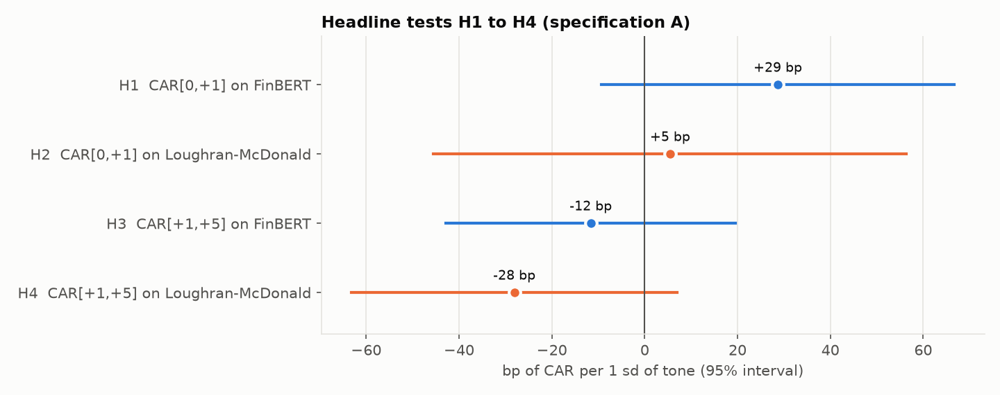
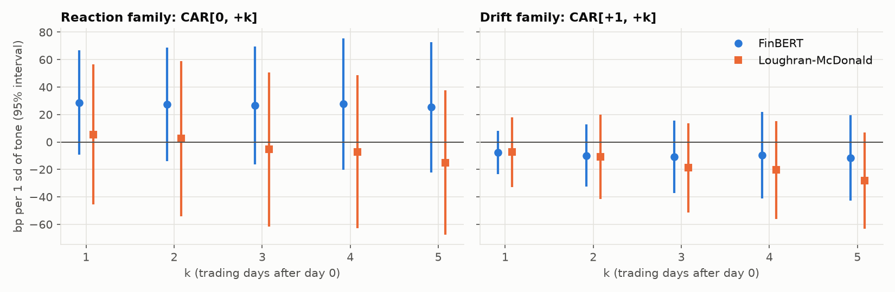
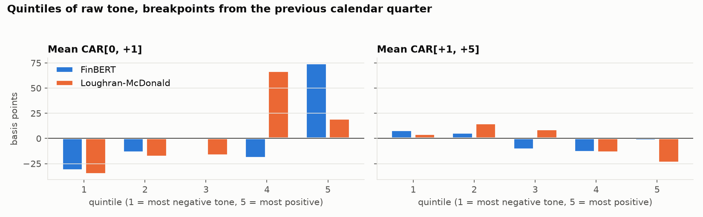
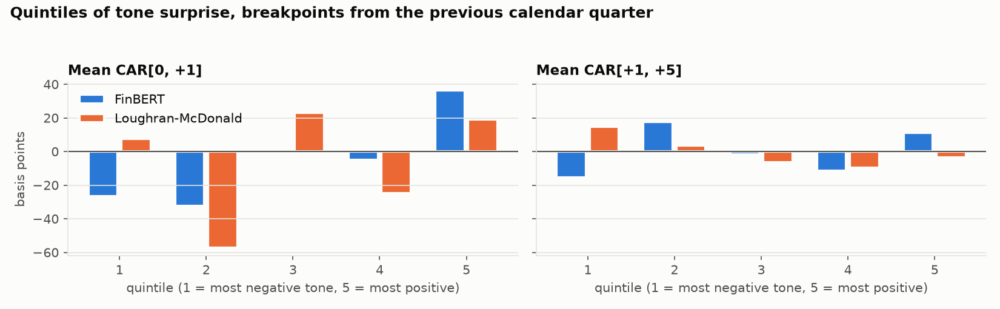

# Stage 4: results

Analysis plan: `docs/stage4_analysis_plan.md`, committed as `24ff20c` before any score was joined to a return. Headline tests: run once and committed as `ca419f6` before any secondary or exploratory analysis. This report is generated by `scripts/17_secondary.py`; the headline table is read from the saved file, not re-run.

All coefficients are in basis points of CAR per one standard deviation of tone. p-values are two-sided.

## 1. Headline results (H1 to H4)

Specification A: firm and calendar-quarter fixed effects, controls for pre-event run-up and volatility (plus the day-0 abnormal return in the drift tests), standard errors clustered by firm and by event day.

| test | family | outcome | regressor | coef_bp | se_bp | ci_low_bp | ci_high_bp | t | p | p_holm | n | clusters |
|---|---|---|---|---|---|---|---|---|---|---|---|---|
| H1 | reaction | car_0_1 | fb_tone | 28.67 | 18.96 | -9.33 | 66.68 | 1.51 | 0.136 | 0.272 | 1315 | firm 55; date 505 |
| H2 | reaction | car_0_1 | lm_tone | 5.47 | 25.41 | -45.48 | 56.42 | 0.22 | 0.830 | 0.830 | 1315 | firm 55; date 505 |
| H3 | drift | car_1_5 | fb_tone | -11.62 | 15.56 | -42.82 | 19.59 | -0.75 | 0.459 | 0.459 | 1315 | firm 55; date 505 |
| H4 | drift | car_1_5 | lm_tone | -28.08 | 17.50 | -63.17 | 7.00 | -1.60 | 0.114 | 0.229 | 1315 | firm 55; date 505 |

**0 of the 4 headline tests are significant at the 5% level after the Holm correction.** None is significant before the correction either (smallest unadjusted p-value: 0.114).

- **H1** (FinBERT, association between tone and the reaction to the same release): +28.7 bp, 95% interval -9.3 to +66.7 bp, p = 0.136, Holm p = 0.272. No effect detected.
- **H2** (Loughran-McDonald, association between tone and the reaction to the same release): +5.5 bp, 95% interval -45.5 to +56.4 bp, p = 0.830, Holm p = 0.830. No effect detected.
- **H3** (FinBERT, prediction of the return over days +1 to +5, beyond what the day-0 reaction already reflects): -11.6 bp, 95% interval -42.8 to +19.6 bp, p = 0.459, Holm p = 0.459. No effect detected.
- **H4** (Loughran-McDonald, prediction of the return over days +1 to +5, beyond what the day-0 reaction already reflects): -28.1 bp, 95% interval -63.2 to +7.0 bp, p = 0.114, Holm p = 0.229. No effect detected.

### Reading the nulls against the power of the test

The plan gave the smallest effect detectable with 80% power assuming independent errors. The realised standard errors:

| test | planned iid SE (bp) | realised two-way clustered SE (bp) | ratio | MDE at 5% with the realised SE (bp) | MDE at 2.5%, strictest Holm step (bp) |
|---|---|---|---|---|---|
| H1 | 19.078 | 18.96 | 0.99 | 53.12 | 58.45 |
| H2 | 23.304 | 25.41 | 1.09 | 71.20 | 78.34 |
| H3 | 12.645 | 15.56 | 1.23 | 43.61 | 47.99 |
| H4 | 15.446 | 17.50 | 1.13 | 49.04 | 53.96 |

A null here means that no effect was detected, not that there is none: effects smaller than the MDE cannot be ruled out. The 95% intervals above give the range of effects that remain compatible with the data.

# Pre-specified secondary analyses

These were listed in the plan. They carry no multiple-testing claim across the whole set and cannot replace the headline results.

## 2. S1: FinBERT and Loughran-McDonald together (specification A)

`p_equal_coefs` tests whether the two coefficients are equal. `r2_gain_from_adding_this_score` is the increase in within R2 when the score is added to a model that already holds the other one.

| family | outcome | regressor | coef_bp | se_bp | ci_low_bp | ci_high_bp | t | p | n | t_equal_coefs | p_equal_coefs | r2_within_both | r2_gain_from_adding_this_score |
|---|---|---|---|---|---|---|---|---|---|---|---|---|---|
| reaction | car_0_1 | fb_tone | 33.85 | 21.18 | -8.62 | 76.32 | 1.60 | 0.116 | 1315 | 1.11 | 0.271 | 0.003 | 0.002 |
| reaction | car_0_1 | lm_tone | -13.68 | 28.75 | -71.31 | 43.96 | -0.48 | 0.636 | 1315 | 1.11 | 0.271 | 0.003 | 0.000 |
| drift | car_1_5 | fb_tone | -1.24 | 18.22 | -37.77 | 35.29 | -0.07 | 0.946 | 1315 | 0.77 | 0.446 | 0.005 | 0.000 |
| drift | car_1_5 | lm_tone | -27.38 | 20.65 | -68.79 | 14.02 | -1.33 | 0.190 | 1315 | 0.77 | 0.446 | 0.005 | 0.002 |

## 3. S2: pooled specification B (sector and calendar-quarter fixed effects)

| family | model | regressor | coef_bp | se_bp | ci_low_bp | ci_high_bp | t | p | n |
|---|---|---|---|---|---|---|---|---|---|
| reaction | alone | fb_tone | 29.14 | 12.06 | 4.97 | 53.32 | 2.42 | 0.019 | 1315 |
| reaction | alone | lm_tone | 33.36 | 11.49 | 10.33 | 56.40 | 2.90 | 0.005 | 1315 |
| reaction | both together | fb_tone | 15.82 | 14.51 | -13.28 | 44.92 | 1.09 | 0.280 | 1315 |
| reaction | both together | lm_tone | 25.12 | 14.01 | -2.96 | 53.20 | 1.79 | 0.079 | 1315 |
| drift | alone | fb_tone | -10.81 | 10.82 | -32.51 | 10.89 | -1.00 | 0.322 | 1315 |
| drift | alone | lm_tone | -8.05 | 9.35 | -26.79 | 10.70 | -0.86 | 0.393 | 1315 |
| drift | both together | fb_tone | -9.04 | 11.61 | -32.31 | 14.24 | -0.78 | 0.440 | 1315 |
| drift | both together | lm_tone | -3.36 | 9.49 | -22.39 | 15.68 | -0.35 | 0.725 | 1315 |

## 4. S3: tone surprise, specification C (calendar-quarter fixed effects)

| family | model | regressor | coef_bp | se_bp | ci_low_bp | ci_high_bp | t | p | n |
|---|---|---|---|---|---|---|---|---|---|
| reaction | alone | fb_tone_surprise | 29.05 | 16.64 | -4.32 | 62.42 | 1.75 | 0.087 | 1087 |
| reaction | alone | lm_tone_surprise | 8.05 | 17.09 | -26.22 | 42.31 | 0.47 | 0.640 | 1087 |
| reaction | both together | fb_tone_surprise | 30.86 | 17.53 | -4.29 | 66.01 | 1.76 | 0.084 | 1087 |
| reaction | both together | lm_tone_surprise | -4.15 | 18.16 | -40.56 | 32.26 | -0.23 | 0.820 | 1087 |
| drift | alone | fb_tone_surprise | -15.88 | 11.54 | -39.01 | 7.26 | -1.38 | 0.175 | 1087 |
| drift | alone | lm_tone_surprise | -16.58 | 13.17 | -42.99 | 9.83 | -1.26 | 0.214 | 1087 |
| drift | both together | fb_tone_surprise | -10.44 | 14.05 | -38.62 | 17.74 | -0.74 | 0.461 | 1087 |
| drift | both together | lm_tone_surprise | -12.47 | 15.57 | -43.68 | 18.74 | -0.80 | 0.427 | 1087 |

## 5. S4: horizon profile (specification A, each score alone)

Holm correction across the five windows of a family, separately for each score.

| family | regressor | outcome | coef_bp | se_bp | ci_low_bp | ci_high_bp | t | p | n | p_holm_across_5_windows |
|---|---|---|---|---|---|---|---|---|---|---|
| reaction | fb_tone | car_0_1 | 28.67 | 18.96 | -9.33 | 66.68 | 1.51 | 0.136 | 1315 | 0.681 |
| reaction | fb_tone | car_0_2 | 27.30 | 20.67 | -14.15 | 68.74 | 1.32 | 0.192 | 1315 | 0.769 |
| reaction | fb_tone | car_0_3 | 26.55 | 21.40 | -16.34 | 69.45 | 1.24 | 0.220 | 1315 | 0.769 |
| reaction | fb_tone | car_0_4 | 27.63 | 23.94 | -20.37 | 75.62 | 1.15 | 0.254 | 1315 | 0.769 |
| reaction | fb_tone | car_0_5 | 25.27 | 23.70 | -22.25 | 72.79 | 1.07 | 0.291 | 1315 | 0.769 |
| reaction | lm_tone | car_0_1 | 5.47 | 25.41 | -45.48 | 56.42 | 0.22 | 0.830 | 1315 | 1.000 |
| reaction | lm_tone | car_0_2 | 2.45 | 28.22 | -54.14 | 59.03 | 0.09 | 0.931 | 1315 | 1.000 |
| reaction | lm_tone | car_0_3 | -5.48 | 28.06 | -61.73 | 50.78 | -0.20 | 0.846 | 1315 | 1.000 |
| reaction | lm_tone | car_0_4 | -7.19 | 27.83 | -62.98 | 48.61 | -0.26 | 0.797 | 1315 | 1.000 |
| reaction | lm_tone | car_0_5 | -14.99 | 26.23 | -67.57 | 37.59 | -0.57 | 0.570 | 1315 | 1.000 |
| drift | fb_tone | ar_1 | -7.62 | 7.90 | -23.46 | 8.23 | -0.96 | 0.340 | 1315 | 1.000 |
| drift | fb_tone | car_1_2 | -9.99 | 11.32 | -32.68 | 12.69 | -0.88 | 0.381 | 1315 | 1.000 |
| drift | fb_tone | car_1_3 | -10.81 | 13.08 | -37.03 | 15.41 | -0.83 | 0.412 | 1315 | 1.000 |
| drift | fb_tone | car_1_4 | -9.67 | 15.79 | -41.31 | 21.98 | -0.61 | 0.543 | 1315 | 1.000 |
| drift | fb_tone | car_1_5 | -11.62 | 15.56 | -42.82 | 19.59 | -0.75 | 0.459 | 1315 | 1.000 |
| drift | lm_tone | ar_1 | -7.41 | 12.72 | -32.92 | 18.10 | -0.58 | 0.563 | 1315 | 1.000 |
| drift | lm_tone | car_1_2 | -10.79 | 15.38 | -41.63 | 20.05 | -0.70 | 0.486 | 1315 | 1.000 |
| drift | lm_tone | car_1_3 | -18.74 | 16.23 | -51.28 | 13.80 | -1.15 | 0.253 | 1315 | 1.000 |
| drift | lm_tone | car_1_4 | -20.42 | 17.82 | -56.16 | 15.31 | -1.15 | 0.257 | 1315 | 1.000 |
| drift | lm_tone | car_1_5 | -28.08 | 17.50 | -63.17 | 7.00 | -1.60 | 0.114 | 1315 | 0.572 |

## 6. S5: quintile sorts

Breakpoints are the 20th to 80th percentiles of the score among the events of the previous calendar quarter. The first quarter with scores is left out. Spread = mean CAR of quintile 5 minus quintile 1, standard error clustered by firm and event day.

### Spreads

| score | family | outcome | events_sorted | quarters | q5_minus_q1_bp | se_bp | t | p |
|---|---|---|---|---|---|---|---|---|
| fb_tone | reaction | car_0_1 | 1262 | 23 | 105.92 | 39.38 | 2.69 | 0.009 |
| fb_tone | drift | car_1_5 | 1262 | 23 | -10.23 | 25.25 | -0.41 | 0.687 |
| lm_tone | reaction | car_0_1 | 1262 | 23 | 54.99 | 37.30 | 1.47 | 0.146 |
| lm_tone | drift | car_1_5 | 1262 | 23 | -28.12 | 29.64 | -0.95 | 0.347 |
| fb_tone_surprise | reaction | car_0_1 | 1034 | 19 | 62.95 | 55.96 | 1.12 | 0.266 |
| fb_tone_surprise | drift | car_1_5 | 1034 | 19 | 26.82 | 33.34 | 0.80 | 0.425 |
| lm_tone_surprise | reaction | car_0_1 | 1034 | 19 | 11.84 | 44.92 | 0.26 | 0.793 |
| lm_tone_surprise | drift | car_1_5 | 1034 | 19 | -18.64 | 29.13 | -0.64 | 0.525 |

### Raw tone: mean CAR by quintile

| score | outcome | Q1 mean (bp) | Q2 mean (bp) | Q3 mean (bp) | Q4 mean (bp) | Q5 mean (bp) | events per quintile |
|---|---|---|---|---|---|---|---|
| fb_tone | car_0_1 | -31.45 | -13.94 | -1.15 | -19.18 | 74.47 | 273 / 256 / 206 / 257 / 270 |
| fb_tone | car_1_5 | 8.31 | 5.65 | -11.00 | -13.17 | -1.92 | 273 / 256 / 206 / 257 / 270 |
| lm_tone | car_0_1 | -35.44 | -17.82 | -16.62 | 66.90 | 19.55 | 276 / 243 / 246 / 238 / 259 |
| lm_tone | car_1_5 | 4.18 | 14.90 | 9.01 | -13.63 | -23.94 | 276 / 243 / 246 / 238 / 259 |

### Tone surprise: mean CAR by quintile

| score | outcome | Q1 mean (bp) | Q2 mean (bp) | Q3 mean (bp) | Q4 mean (bp) | Q5 mean (bp) | events per quintile |
|---|---|---|---|---|---|---|---|
| fb_tone_surprise | car_0_1 | -26.58 | -32.49 | -1.17 | -5.00 | 36.36 | 235 / 197 / 183 / 186 / 233 |
| fb_tone_surprise | car_1_5 | -15.51 | 17.50 | -1.74 | -11.53 | 11.31 | 235 / 197 / 183 / 186 / 233 |
| lm_tone_surprise | car_0_1 | 7.41 | -57.36 | 23.15 | -24.98 | 19.25 | 231 / 186 / 202 / 204 / 211 |
| lm_tone_surprise | car_1_5 | 14.90 | 3.61 | -6.61 | -9.87 | -3.74 | 231 / 186 / 202 / 204 / 211 |

## 7. S6: other clusterings for H1 to H4

Same point estimates; only the standard errors change. Calendar-quarter clustering has 24 clusters, which is few.

| test | clustering | coef_bp | se_bp | ci_low_bp | ci_high_bp | t | p | n | clusters |
|---|---|---|---|---|---|---|---|---|---|
| H1 | twoway | 28.67 | 18.96 | -9.33 | 66.68 | 1.51 | 0.136 | 1315 | firm 55; date 505 |
| H1 | firm | 28.67 | 19.07 | -9.57 | 66.92 | 1.50 | 0.139 | 1315 | firm 55 |
| H1 | quarter | 28.67 | 20.26 | -13.24 | 70.59 | 1.42 | 0.170 | 1315 | quarter 24 |
| H2 | twoway | 5.47 | 25.41 | -45.48 | 56.42 | 0.22 | 0.830 | 1315 | firm 55; date 505 |
| H2 | firm | 5.47 | 25.12 | -44.89 | 55.83 | 0.22 | 0.828 | 1315 | firm 55 |
| H2 | quarter | 5.47 | 29.38 | -55.32 | 66.25 | 0.19 | 0.854 | 1315 | quarter 24 |
| H3 | twoway | -11.62 | 15.56 | -42.82 | 19.59 | -0.75 | 0.459 | 1315 | firm 55; date 505 |
| H3 | firm | -11.62 | 14.98 | -41.66 | 18.42 | -0.78 | 0.441 | 1315 | firm 55 |
| H3 | quarter | -11.62 | 21.06 | -55.19 | 31.95 | -0.55 | 0.587 | 1315 | quarter 24 |
| H4 | twoway | -28.08 | 17.50 | -63.17 | 7.00 | -1.60 | 0.114 | 1315 | firm 55; date 505 |
| H4 | firm | -28.08 | 16.57 | -61.31 | 5.14 | -1.69 | 0.096 | 1315 | firm 55 |
| H4 | quarter | -28.08 | 19.56 | -68.54 | 12.37 | -1.44 | 0.164 | 1315 | quarter 24 |

## 8. S7: sample robustness for H1 to H4

| sample | test | coef_bp | se_bp | ci_low_bp | ci_high_bp | t | p | n |
|---|---|---|---|---|---|---|---|---|
| headline sample | H1 | 28.67 | 18.96 | -9.33 | 66.68 | 1.51 | 0.136 | 1315 |
| headline sample | H2 | 5.47 | 25.41 | -45.48 | 56.42 | 0.22 | 0.830 | 1315 |
| headline sample | H3 | -11.62 | 15.56 | -42.82 | 19.59 | -0.75 | 0.459 | 1315 |
| headline sample | H4 | -28.08 | 17.50 | -63.17 | 7.00 | -1.60 | 0.114 | 1315 |
| without pre-announced quarters | H1 | 23.94 | 19.90 | -15.96 | 63.84 | 1.20 | 0.234 | 1264 |
| without pre-announced quarters | H2 | 2.22 | 25.87 | -49.64 | 54.09 | 0.09 | 0.932 | 1264 |
| without pre-announced quarters | H3 | -17.20 | 15.99 | -49.26 | 14.86 | -1.08 | 0.287 | 1264 |
| without pre-announced quarters | H4 | -28.53 | 18.53 | -65.67 | 8.61 | -1.54 | 0.129 | 1264 |
| without market-hours events | H1 | 30.93 | 19.60 | -8.37 | 70.23 | 1.58 | 0.120 | 1292 |
| without market-hours events | H2 | 7.39 | 25.66 | -44.05 | 58.83 | 0.29 | 0.775 | 1292 |
| without market-hours events | H3 | -10.69 | 15.67 | -42.10 | 20.72 | -0.68 | 0.498 | 1292 |
| without market-hours events | H4 | -27.19 | 17.85 | -62.99 | 8.60 | -1.52 | 0.134 | 1292 |
| without clock-adjusted events | H1 | 28.62 | 18.79 | -9.06 | 66.30 | 1.52 | 0.134 | 1300 |
| without clock-adjusted events | H2 | 5.37 | 25.59 | -45.94 | 56.68 | 0.21 | 0.835 | 1300 |
| without clock-adjusted events | H3 | -10.58 | 15.46 | -41.58 | 20.42 | -0.68 | 0.497 | 1300 |
| without clock-adjusted events | H4 | -27.64 | 17.62 | -62.97 | 7.69 | -1.57 | 0.123 | 1300 |
| without hand-reviewed gap fills | H1 | 28.60 | 18.96 | -9.40 | 66.61 | 1.51 | 0.137 | 1312 |
| without hand-reviewed gap fills | H2 | 5.90 | 25.48 | -45.19 | 56.98 | 0.23 | 0.818 | 1312 |
| without hand-reviewed gap fills | H3 | -12.07 | 15.60 | -43.35 | 19.21 | -0.77 | 0.443 | 1312 |
| without hand-reviewed gap fills | H4 | -27.36 | 17.45 | -62.35 | 7.62 | -1.57 | 0.123 | 1312 |
| only events with tone surprise (specification C sample) | H1 | 28.67 | 22.58 | -16.60 | 73.94 | 1.27 | 0.210 | 1087 |
| only events with tone surprise (specification C sample) | H2 | 7.27 | 29.16 | -51.19 | 65.73 | 0.25 | 0.804 | 1087 |
| only events with tone surprise (specification C sample) | H3 | -14.73 | 18.28 | -51.38 | 21.92 | -0.81 | 0.424 | 1087 |
| only events with tone surprise (specification C sample) | H4 | -36.28 | 19.46 | -75.28 | 2.73 | -1.86 | 0.068 | 1087 |

## 9. S8: measurement robustness for H1 to H4

One element changes per row; controls stay as in the headline equations.

| variant | test | regressor | outcome | coef_bp | se_bp | ci_low_bp | ci_high_bp | t | p | n |
|---|---|---|---|---|---|---|---|---|---|---|
| safe-harbor text kept | H1 | fb_tone_sh | car_0_1 | 35.62 | 19.18 | -2.84 | 74.08 | 1.86 | 0.069 | 1315 |
| safe-harbor text kept | H2 | lm_tone_sh | car_0_1 | 18.65 | 23.58 | -28.62 | 65.92 | 0.79 | 0.432 | 1315 |
| safe-harbor text kept | H3 | fb_tone_sh | car_1_5 | -7.81 | 16.83 | -41.56 | 25.93 | -0.46 | 0.644 | 1315 |
| safe-harbor text kept | H4 | lm_tone_sh | car_1_5 | -21.40 | 17.38 | -56.25 | 13.45 | -1.23 | 0.224 | 1315 |
| FinBERT label shares (fb_tone_labels) | H1 | fb_tone_labels | car_0_1 | 28.23 | 18.28 | -8.41 | 64.87 | 1.54 | 0.128 | 1315 |
| FinBERT label shares (fb_tone_labels) | H3 | fb_tone_labels | car_1_5 | -10.87 | 16.25 | -43.46 | 21.71 | -0.67 | 0.506 | 1315 |
| dictionary tone per word (lm_tone_per_word) | H2 | lm_tone_per_word | car_0_1 | -2.53 | 25.57 | -53.80 | 48.74 | -0.10 | 0.922 | 1315 |
| dictionary tone per word (lm_tone_per_word) | H4 | lm_tone_per_word | car_1_5 | -22.95 | 16.27 | -55.58 | 9.67 | -1.41 | 0.164 | 1315 |
| Fama-French 4-factor CARs | H1 | fb_tone | car_0_1_ff4 | 31.21 | 17.49 | -3.85 | 66.28 | 1.78 | 0.080 | 1315 |
| Fama-French 4-factor CARs | H2 | lm_tone | car_0_1_ff4 | -0.63 | 23.44 | -47.63 | 46.37 | -0.03 | 0.979 | 1315 |
| Fama-French 4-factor CARs | H3 | fb_tone | car_1_5_ff4 | -11.69 | 14.55 | -40.86 | 17.48 | -0.80 | 0.425 | 1315 |
| Fama-French 4-factor CARs | H4 | lm_tone | car_1_5_ff4 | -22.45 | 16.42 | -55.37 | 10.48 | -1.37 | 0.177 | 1315 |
| sector-ETF CARs | H1 | fb_tone | car_0_1_sector | 20.46 | 16.31 | -12.25 | 53.17 | 1.25 | 0.215 | 1315 |
| sector-ETF CARs | H2 | lm_tone | car_0_1_sector | -2.44 | 21.14 | -44.83 | 39.94 | -0.12 | 0.908 | 1315 |
| sector-ETF CARs | H3 | fb_tone | car_1_5_sector | -8.49 | 10.01 | -28.56 | 11.57 | -0.85 | 0.400 | 1315 |
| sector-ETF CARs | H4 | lm_tone | car_1_5_sector | -15.24 | 13.29 | -41.88 | 11.41 | -1.15 | 0.257 | 1315 |
| CARs winsorised at 1% and 99% | H1 | fb_tone | car_0_1_w | 29.39 | 17.98 | -6.65 | 65.43 | 1.63 | 0.108 | 1315 |
| CARs winsorised at 1% and 99% | H2 | lm_tone | car_0_1_w | 7.20 | 24.22 | -41.36 | 55.76 | 0.30 | 0.767 | 1315 |
| CARs winsorised at 1% and 99% | H3 | fb_tone | car_1_5_w | -14.69 | 13.39 | -41.53 | 12.15 | -1.10 | 0.277 | 1315 |
| CARs winsorised at 1% and 99% | H4 | lm_tone | car_1_5_w | -26.83 | 17.03 | -60.98 | 7.32 | -1.58 | 0.121 | 1315 |
| buy-and-hold abnormal returns | H1 | fb_tone | bhar_0_1 | 28.55 | 18.89 | -9.32 | 66.42 | 1.51 | 0.136 | 1315 |
| buy-and-hold abnormal returns | H2 | lm_tone | bhar_0_1 | 5.93 | 25.28 | -44.75 | 56.62 | 0.23 | 0.815 | 1315 |
| buy-and-hold abnormal returns | H3 | fb_tone | bhar_1_5 | -11.21 | 15.93 | -43.14 | 20.72 | -0.70 | 0.485 | 1315 |
| buy-and-hold abnormal returns | H4 | lm_tone | bhar_1_5 | -27.59 | 17.28 | -62.24 | 7.06 | -1.60 | 0.116 | 1315 |

## 10. Count of nominally significant secondary coefficients

Across S1, S2, S3, S4, S7 and S8 there are 88 coefficient estimates. **2** have an unadjusted p-value below 0.05 (about 4 would be expected by chance alone if every true effect were zero, and the estimates are far from independent). Quintile spreads below 0.05: 1 of 8.

They are listed here in full so that none is hidden:

| src | family | model | sample | variant | test | regressor | outcome | coef_bp | se_bp | t | p |
|---|---|---|---|---|---|---|---|---|---|---|---|
| s2_pooled_spec_B | reaction | alone |  |  |  | fb_tone |  | 29.14 | 12.06 | 2.42 | 0.019 |
| s2_pooled_spec_B | reaction | alone |  |  |  | lm_tone |  | 33.36 | 11.49 | 2.90 | 0.005 |

# Exploratory analyses (not tests of the hypothesis)

Nothing in this part was a pre-specified test. It is descriptive, is not corrected for multiple comparisons, and must not be read as confirming or rejecting the hypothesis.

## 11. Exploratory: rank correlations between tone and CAR

Spearman correlations with 95% intervals from 1,000 bootstrap resamples of firms. No controls and no fixed effects in the pooled version; firm means removed in the within-firm version.

| family | outcome | version | quantity | spearman | ci_low | ci_high |
|---|---|---|---|---|---|---|
| reaction | car_0_1 | pooled | FinBERT | 0.062 | 0.004 | 0.111 |
| reaction | car_0_1 | pooled | Loughran-McDonald | 0.061 | 0.008 | 0.109 |
| reaction | car_0_1 | pooled | FinBERT minus Loughran-McDonald | 0.001 | -0.046 | 0.046 |
| reaction | car_0_1 | within firm | FinBERT | 0.052 | -0.011 | 0.111 |
| reaction | car_0_1 | within firm | Loughran-McDonald | 0.027 | -0.024 | 0.081 |
| reaction | car_0_1 | within firm | FinBERT minus Loughran-McDonald | 0.025 | -0.034 | 0.080 |
| drift | car_1_5 | pooled | FinBERT | -0.019 | -0.076 | 0.040 |
| drift | car_1_5 | pooled | Loughran-McDonald | -0.020 | -0.080 | 0.034 |
| drift | car_1_5 | pooled | FinBERT minus Loughran-McDonald | 0.002 | -0.053 | 0.057 |
| drift | car_1_5 | within firm | FinBERT | -0.004 | -0.064 | 0.053 |
| drift | car_1_5 | within firm | Loughran-McDonald | -0.024 | -0.082 | 0.032 |
| drift | car_1_5 | within firm | FinBERT minus Loughran-McDonald | 0.020 | -0.041 | 0.080 |

## 12. Exploratory: specification A in sub-samples

| split | family | regressor | coef_bp | se_bp | ci_low_bp | ci_high_bp | t | p | n |
|---|---|---|---|---|---|---|---|---|---|
| 2020 only | reaction | fb_tone | -10.96 | 64.64 | -140.56 | 118.64 | -0.17 | 0.866 | 220 |
| 2020 only | reaction | lm_tone | 27.20 | 95.96 | -165.17 | 219.58 | 0.28 | 0.778 | 220 |
| 2020 only | drift | fb_tone | -39.65 | 65.65 | -171.28 | 91.97 | -0.60 | 0.548 | 220 |
| 2020 only | drift | lm_tone | -33.36 | 60.06 | -153.78 | 87.06 | -0.56 | 0.581 | 220 |
| all years except 2020 | reaction | fb_tone | 31.75 | 23.90 | -16.16 | 79.66 | 1.33 | 0.190 | 1095 |
| all years except 2020 | reaction | lm_tone | -3.37 | 26.27 | -56.04 | 49.30 | -0.13 | 0.899 | 1095 |
| all years except 2020 | drift | fb_tone | -9.70 | 15.46 | -40.70 | 21.30 | -0.63 | 0.533 | 1095 |
| all years except 2020 | drift | lm_tone | -29.93 | 21.68 | -73.39 | 13.54 | -1.38 | 0.173 | 1095 |
| pre-open events | reaction | fb_tone | 28.76 | 19.99 | -11.56 | 69.08 | 1.44 | 0.158 | 937 |
| pre-open events | reaction | lm_tone | 0.73 | 24.44 | -48.57 | 50.03 | 0.03 | 0.976 | 937 |
| pre-open events | drift | fb_tone | -33.63 | 13.64 | -61.15 | -6.11 | -2.46 | 0.018 | 937 |
| pre-open events | drift | lm_tone | -22.97 | 17.01 | -57.26 | 11.33 | -1.35 | 0.184 | 937 |
| after-close events | reaction | fb_tone | 18.55 | 55.73 | -99.59 | 136.69 | 0.33 | 0.744 | 355 |
| after-close events | reaction | lm_tone | 19.45 | 83.77 | -158.14 | 197.03 | 0.23 | 0.819 | 355 |
| after-close events | drift | fb_tone | 59.82 | 31.34 | -6.61 | 126.26 | 1.91 | 0.074 | 355 |
| after-close events | drift | lm_tone | -50.14 | 58.31 | -173.76 | 73.47 | -0.86 | 0.403 | 355 |
| larger half of firms | reaction | fb_tone | 3.71 | 28.75 | -55.28 | 62.69 | 0.13 | 0.898 | 670 |
| larger half of firms | reaction | lm_tone | -0.90 | 37.12 | -77.06 | 75.27 | -0.02 | 0.981 | 670 |
| larger half of firms | drift | fb_tone | -29.21 | 17.27 | -64.63 | 6.22 | -1.69 | 0.102 | 670 |
| larger half of firms | drift | lm_tone | -23.59 | 24.40 | -73.65 | 26.47 | -0.97 | 0.342 | 670 |
| smaller half of firms | reaction | fb_tone | 44.99 | 22.87 | -2.01 | 92.00 | 1.97 | 0.060 | 645 |
| smaller half of firms | reaction | lm_tone | 6.96 | 33.56 | -62.02 | 75.95 | 0.21 | 0.837 | 645 |
| smaller half of firms | drift | fb_tone | -1.40 | 25.37 | -53.54 | 50.74 | -0.06 | 0.956 | 645 |
| smaller half of firms | drift | lm_tone | -35.06 | 25.77 | -88.03 | 17.90 | -1.36 | 0.185 | 645 |

## 13. Exploratory: other variants

The row without the day-0 control re-estimates the drift equation with that control removed, to show the total association rather than the part beyond the day-0 reaction.

| analysis | family | regressor | coef_bp | se_bp | ci_low_bp | ci_high_bp | t | p | n |
|---|---|---|---|---|---|---|---|---|---|
| share of positive / negative FinBERT sentences | reaction | fb_share_pos | 25.44 | 22.75 | -20.17 | 71.05 | 1.12 | 0.268 | 1315 |
| share of positive / negative FinBERT sentences | reaction | fb_share_neg | -29.76 | 24.96 | -79.79 | 20.27 | -1.19 | 0.238 | 1315 |
| share of positive / negative FinBERT sentences | drift | fb_share_pos | -22.92 | 18.27 | -59.55 | 13.71 | -1.25 | 0.215 | 1315 |
| share of positive / negative FinBERT sentences | drift | fb_share_neg | -4.34 | 16.33 | -37.09 | 28.40 | -0.27 | 0.791 | 1315 |
| drift equation WITHOUT the day-0 return control (total association) | drift | fb_tone | -10.24 | 15.23 | -40.78 | 20.30 | -0.67 | 0.504 | 1315 |
| CAR[0,+5] (reaction and drift together) | both | fb_tone | 25.27 | 23.70 | -22.25 | 72.79 | 1.07 | 0.291 | 1315 |
| drift equation WITHOUT the day-0 return control (total association) | drift | lm_tone | -27.60 | 17.53 | -62.74 | 7.54 | -1.57 | 0.121 | 1315 |
| CAR[0,+5] (reaction and drift together) | both | lm_tone | -14.99 | 26.23 | -67.57 | 37.59 | -0.57 | 0.570 | 1315 |

The earnings-surprise control named in the plan as exploratory was **not** run: the EPS history was not assembled.

# Deviations from the analysis plan

**None.** Equations, samples, tests, clustering and the Holm correction were applied as written.

Clarifications of points the plan left open (decided before looking at any result of the item concerned):

- Standard errors use the small-sample correction G/(G-1) x (N-1)/(N-K) for each clustering dimension and a t distribution with (smallest number of clusters - 1) degrees of freedom. This is the convention validated in `docs/stage4_validation.md`.
- In S8, when the outcome is computed with another expected-return model, the controls (run-up, volatility, day-0 return) stay the market-model ones.
- In S5, the quintile spread comes from a regression of the CAR on quintile indicators with no fixed effects and no controls.
- S7 uses the plan's four flags and the specification C sample; no other sample was tried.
